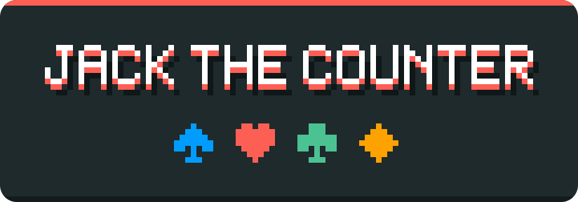

<p align="center">
  
</p>

<p align="center"><b>Learn to count cards at blackjack and beat the evil dealer.</b></p>

<p align="center">
  <a href="https://jack-the-counter.pages.dev"></a>
  <a href="https://github.com/PennecStv/JackTheCounter/actions/workflows/deploy.yml"></a>
  <a href="https://github.com/PennecStv/JackTheCounter/tags"></a>
  <a href="LICENSE"></a>
  <br>
  
  
  
  
  
</p>

Play the test build online, with every ante unlocked: https://jack-the-counter.pages.dev

Practise card counting across eight antes: ante N deals from an N-deck shoe, a little faster each time.
Every few rounds the table is swept and you give the running count; from ante 2 you also give the true count.
Three wrong answers end the run, lives left become stars, and clearing an ante unlocks the next.

- Pixel-art cards, dealt one by one with a card sound.
- Four counts to train: Hi-Lo, KO (running count only, starting at 4 − 4 × decks as in the KO book), Omega II and Zen, each with its own progress.
- For each count, the menu explains what counting is for and what to bet and play at each count value.
- Deal speed from ×0.75 to ×3, set from the menu or during a game.
- Answers are given with a counter (− and + buttons) and a slider, by touch or keyboard (+, −, arrows, Enter).
- A Retry button restarts the ante at any time.
- As at a real table, a finished hand waits on the table until you press Next hand, or moves on by itself with Auto next hand.
- Each hand shows its total, and an eye button keeps the running and true count on screen while you learn.
- Each hand ends with who won: blackjack, win, push, lose or bust, animated on the table.
- A recap of every round dealt so far, with each card's value and the running count after each round.
- Card sounds on every deal and soft jingles for answers and results, which can be turned off.
- English and French, picked from the browser language and switchable on the menu.
- Guides from the menu: blackjack rules, basic strategy charts with the Hi-Lo index plays, and a counter's handbook, which also compares the counts, including CAC2, a paid count whose card values are private.

## Run

```bash
npm install
npm run dev      # http://localhost:5173
npm test         # game engine tests (node:test)
npm run build    # static site in dist/, with service worker
npm run staging  # test build with every ante unlocked, served on the local network (port 4173)
```

Built with Vite, React, TypeScript and Tailwind CSS. The game engine is in `src/game.ts`, with no React in it.

## Deploy

The test build is hosted on Cloudflare Pages, in the `jack-the-counter` project. Every push to `main`
is tested, built and deployed there by `.github/workflows/deploy.yml`. To deploy by hand, after `npx wrangler login`:

```bash
npx vite build --mode staging   # or `npm run build` for the real game, with antes locked
npx wrangler pages deploy dist --project-name jack-the-counter --branch main
```

Any static host over HTTPS works the same way: upload `dist/`.

## On a phone

The build is a PWA. Open the site on the phone, then "Add to Home Screen" (iOS Safari) or
"Install app" (Android Chrome). It runs full screen and offline.
After a deploy, reload the page twice to get the new version.

## Credits

Colours come from the Balatro modding palette in
[balamod/aseprite-balamod-extension](https://github.com/balamod/aseprite-balamod-extension) (`UI.gpl`).
Card faces and backs: [Pixel Cards](https://jfredd.itch.io/pixel-cards) by Jfred (CC0), in `public/cards/`.
Suits, jingles and the swirl background are made in code; no Balatro sprites are included.
The card sound is `src/assets/card.mp3`, supplied with the project.
Font: [Jersey 10](https://fonts.google.com/specimen/Jersey+10) (OFL).
